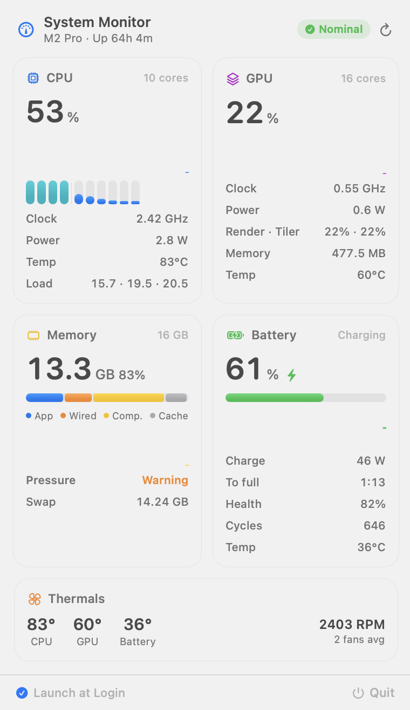
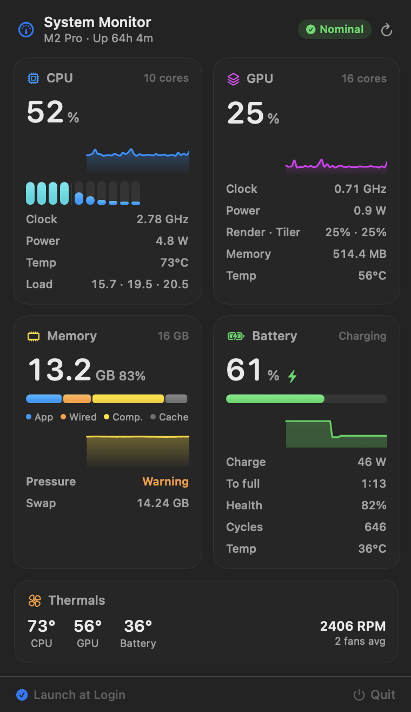

# MacStatusBarMonitor

A native macOS menu bar system monitor (Swift + SwiftUI + `MenuBarExtra`,
macOS 13+, zero third-party dependencies). A compact Control-Center-style
dashboard: CPU, GPU, memory and battery cards, each with a 60-second
sparkline, plus a thermals strip. Menu bar label: `CPU 23% · MEM 61%`.

 

## What it shows

| Card | Data |
|---|---|
| **CPU** | usage, per-core bars (efficiency vs performance cores), live clock, package power, temperature, load average |
| **GPU** | utilization, live clock, power, renderer / tiler load, memory in use, temperature |
| **Memory** | used vs total, segmented App / Wired / Compressed / Cache bar, memory pressure, swap |
| **Battery** | level, charge / draw in watts, time remaining, health (max vs design capacity), cycle count, temperature |
| **Thermals** | CPU / GPU / battery temperature, fan speed, thermal-pressure badge |

Anything the OS doesn't expose without elevated privileges is shown as `—`
or "Unavailable" rather than guessed (for example, per-process GPU usage and
per-GPU-core load).

## Build

Open `MacStatusBarMonitor.xcodeproj` in Xcode and press Run, or from the
command line:

```sh
DEVELOPER_DIR=/Applications/Xcode.app/Contents/Developer \
  xcodebuild -project MacStatusBarMonitor.xcodeproj \
             -scheme MacStatusBarMonitor -configuration Debug build
```

`DEVELOPER_DIR` is only needed if `xcode-select` points at the Command Line
Tools instead of Xcode.app.

> Note: build via the **scheme** (products land in `~/Library/Developer/...`),
> not `-target` (products would land in `./build`). This folder lives under
> an iCloud-synced Desktop, and the File Provider adds Finder-info extended
> attributes to fresh bundles, which makes `codesign` fail with "resource
> fork, Finder information, or similar detritus not allowed".

## Run

```sh
open "$(DEVELOPER_DIR=/Applications/Xcode.app/Contents/Developer \
  xcodebuild -project MacStatusBarMonitor.xcodeproj -scheme MacStatusBarMonitor \
  -configuration Debug -showBuildSettings 2>/dev/null \
  | awk '/BUILT_PRODUCTS_DIR/{print $3; exit}')/MacStatusBarMonitor.app"
```

or copy to `/Applications` first:

```sh
ditto <built .app> /Applications/MacStatusBarMonitor.app
open /Applications/MacStatusBarMonitor.app
```

## Heads-up: full menu bars on notched MacBooks

macOS parks new status items **under the camera notch** when the menu bar is
already full — the item exists but cannot be seen, and there is no API to
reposition it. The app detects this and logs a warning (visible in Console or
when launched from a terminal). Fix: remove some menu bar icons
(System Settings → Control Center) or use an external display.

## Architecture

```
MacStatusBarMonitor/
├── MacStatusBarMonitorApp.swift     @main, MenuBarExtra scene, notch warning
├── Models/
│   └── SystemStats.swift            value types, 60 s history, formatting helpers
├── Providers/
│   ├── SystemStatsProvider.swift    coordinator + StatsStore (ObservableObject)
│   ├── CPUProvider.swift            host_statistics / per-core ticks (E/P split)
│   ├── GPUProvider.swift            IOAccelerator PerformanceStatistics
│   ├── ClockProvider.swift          live CPU/GPU clock + power (IOReport)
│   ├── MemoryProvider.swift         host_statistics64, swap, memory pressure
│   ├── BatteryProvider.swift        IOKit power sources + AppleSmartBattery
│   ├── HardwareSensorProvider.swift sensors — discovery + reads
│   ├── SMC.swift                    raw AppleSMC user client
│   ├── DeviceInfoProvider.swift     chip name, static max clocks (cached)
│   └── LoginItemManager.swift       Launch at Login (SMAppService)
└── Views/
    ├── MenuBarView.swift            panel layout + menu bar label + footer
    ├── DashboardCards.swift         sparkline, CPU/GPU/Memory/Battery/Thermal cards
    └── SharedStyle.swift            status badge + load/battery color ramps
```

Refresh model: a 2-second timer collects everything off the main thread.
The menu bar label observes a tiny separate model (updated only when the text
changes); the full stats snapshot is only published while the panel is open,
and the expensive collector (SMC) is skipped while it's closed —
idle cost stays ~1–3% of one core.

## V2 sensors and their limitation

Temperatures and fan speeds come from the SMC via the `AppleSMC` IOKit user
client (`SMC.swift` + `HardwareSensorProvider.swift`). Reads need **no sudo,
no helper, no entitlements**, but the interface is **not a documented public
API**. Battery temperature is read from the public-ish `AppleSmartBattery`
IORegistry entry first (deci-Kelvin units). Every sensor call fails soft: if
anything is unavailable the UI shows "Unavailable" and V1 is unaffected.
Sensor keys differ per chip generation, so the provider enumerates all SMC
keys once and keeps plausible `Tp/Tc/TC` (CPU), `Tg/TG` (GPU), `TB*T`
(battery) and `F*Ac` (fan) keys instead of hardcoding one chip's list.

## Tools

`tools/` contains small harnesses used during development (not part of the
app target): an offscreen UI renderer (`PreviewMain.swift` → PNGs of the
panel in light/dark), an SMC probe (`tools/probe/main.swift`), a MenuBarExtra
window diagnostic (`DiagMain.swift`), and CPU-cost experiments. Example:

```sh
SRCS=$(find MacStatusBarMonitor/Models MacStatusBarMonitor/Providers MacStatusBarMonitor/Views -name '*.swift')
swiftc -parse-as-library -target arm64-apple-macos13.0 $SRCS tools/PreviewMain.swift -o /tmp/msbm_preview
/tmp/msbm_preview   # writes /tmp/msbm_panel_{light,dark}.png
```
